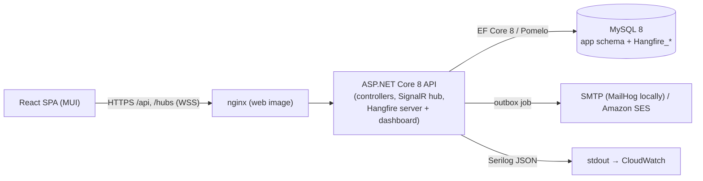

# Architecture

## Shape

One deployable API process serves HTTP, the SignalR hub and the Hangfire job server (`Jobs:RunServer` turns the job server off on HTTP-only instances). The web image is static files behind nginx, which also proxies `/api`, `/hubs`, `/health` and `/hangfire` to the API, so the browser sees one origin.

## Backend layers

| Project | Holds | Depends on |
| --- | --- | --- |
| `ReworkGuard.Domain` | Entities with their invariants, enums, `TaskStateMachine`, warranty/deductibility policies, attribution calculator, `DeductionCalculator`, the payroll allocation engine, IST calendar. Pure C#, no I/O. | nothing |
| `ReworkGuard.Application` | Use-case services (tasks, bugs, time logs, deductions, disputes, payroll runs, payslips, reports, audit, auth, admin, jobs), DTOs, FluentValidation validators, abstractions (`IApplicationDbContext`, `IClock`, `IAuditWriter`, `INotificationSender`, …). | Domain, EF Core abstractions |
| `ReworkGuard.Infrastructure` | EF Core context, configurations and migrations, MySQL-specific SQL (row locks, audit chain trigger, payroll guards), JWT, password hashing, Hangfire wiring, SMTP/SES email, QuestPDF and ClosedXML renderers, audit chain verifier, seeder. | Application |
| `ReworkGuard.Api` | Controllers under `/api/v1`, ProblemDetails mapping, authentication and role policies, rate limiting, correlation id and security-header middleware, SignalR hub, Hangfire dashboard auth, Development-only tools. | Application, Infrastructure |

Rules that keep the layers honest: services use `IApplicationDbContext` (no repositories, see DEFERRED.md); every controller action declares its roles with `[Authorize(Roles = …)]` and a reflection test fails the build otherwise ([AUTHORIZATION_MATRIX.md](AUTHORIZATION_MATRIX.md) is generated from that); row-level rules (own records, team scope) live in the services.

## A write, end to end

1. Controller validates the bearer token and role, binds the request, calls the service.
2. The service validates (FluentValidation → 400), opens a transaction when it needs row locks (`LockEmployeeAsync`, `LockPayrollPeriodAsync` use `SELECT … FOR UPDATE`), loads aggregates and calls domain methods, which throw `DomainException` (→ 409 with a `code`) when a rule is broken.
3. In the same unit of work it records `AuditEvent`s (`IAuditWriter`), re-syncs the deduction ledger if hours/review/attribution changed, and queues notifications as `Notification` + `OutboxMessage` rows.
4. `SaveChanges` checks `Version` concurrency tokens (stale → 409 `concurrency`); MySQL triggers chain the audit rows and guard append-only tables.
5. After commit, the outbox job (every 15 s) pushes in-app notifications over SignalR and sends email, with retries and backoff. Nothing is sent for a rolled-back change.

## Background jobs (Hangfire, MySQL storage, times in IST)

| Job | Schedule | Does |
| --- | --- | --- |
| `outbox-delivery` | every 15 s | Delivers outbox messages (SignalR + email), exponential backoff, marked dead after 5 attempts (retry from Admin → Operations) |
| `deduction-windows` | every 5 min | Reminds employees 24 h before a dispute window closes, records window expiry, reminds managers of open disputes |
| `warranty-sweep` | 01:30 daily | Closes tasks whose warranty has expired and that have no open bugs |
| `daily-reminders` | 09:00 Mon–Fri | Approvers with pending logs, managers with draft lines |

Jobs are idempotent, not retried by Hangfire, and serialised with a distributed lock. Admins see last/next run and can trigger a job from **Operations**; the Hangfire dashboard is behind a separate Admin-only cookie.

## Payroll engine

`PayrollRunService` builds the inputs for a month (approved lines due, carry-forward from the previous locked run, refunds, each employee's salary base and cap), hands them to the pure allocation engine in `Domain/Payroll`, and stores the result as `PayrollRun` → `PayrollRunEmployee` → `PayrollRunItem`. The inputs are hashed at approval; finalize recomputes and refuses if the hash changed. Reconciliation runs six checks at finalize (recomputed figures match, every line fully accounted for, no deduction above the cap, totals add up, lines still approved and unclaimed, carry-forward continues from the previous month) and is stored on the run as JSON. Payslips are views of locked runs, rendered to PDF with QuestPDF on request.

## Audit chain

`AuditEvents` rows get `Sequence`, `PrevHash` and `Hash` from a BEFORE INSERT trigger that locks the single `AuditChainHead` row, so concurrent writers produce one linear chain. `GET /api/v1/audit/verify` recomputes every hash in SQL with a window function and reports the first break (hash, gap, link or head mismatch). See [SECURITY.md](SECURITY.md).

## Frontend

React 19 + TypeScript (strict), Vite, MUI 6, TanStack Query, React Router, React Hook Form + Zod, recharts, `@microsoft/signalr`. `src/api/client.ts` holds the access token in memory only; the refresh token is an HttpOnly cookie scoped to `/api/v1/auth`, and a 401 triggers one shared refresh then a retry. Routes are guarded by role (`RequireAuth`), mirroring the server, which remains the authority. Notifications arrive over SignalR and invalidate the matching queries.

## Deployment

Locally: `docker compose` (MySQL, API, web, MailHog). Production reference: ECS Fargate (API, web, one-off migrator task built as an EF migrations bundle), RDS MySQL, SES, Secrets Manager, ALB; see [AWS_DEPLOYMENT.md](AWS_DEPLOYMENT.md) and [OPERATIONS.md](OPERATIONS.md). CI: build with warnings as errors, migration drift check, tests with coverage, vulnerable-package checks, gitleaks, Trivy, compose smoke test with the demo seed, CodeQL.

## Key decisions

- **MySQL triggers and grants, not only application code, protect history.** A bug or a compromised app account cannot rewrite audit, state history or locked payroll rows.
- **Transactional outbox** for every notification so people are never told about a change that did not commit.
- **Compensating lines instead of edits** once a line is finalized, so every payslip can be reproduced from its run.
- **Months strictly in order with a locked-month router**, so late changes always land in an open month and carry-forward is never computed twice.
- **One process** for HTTP, hub and jobs to keep operations simple at the expected size (hundreds of employees); scale-out notes are in OPERATIONS.md.
